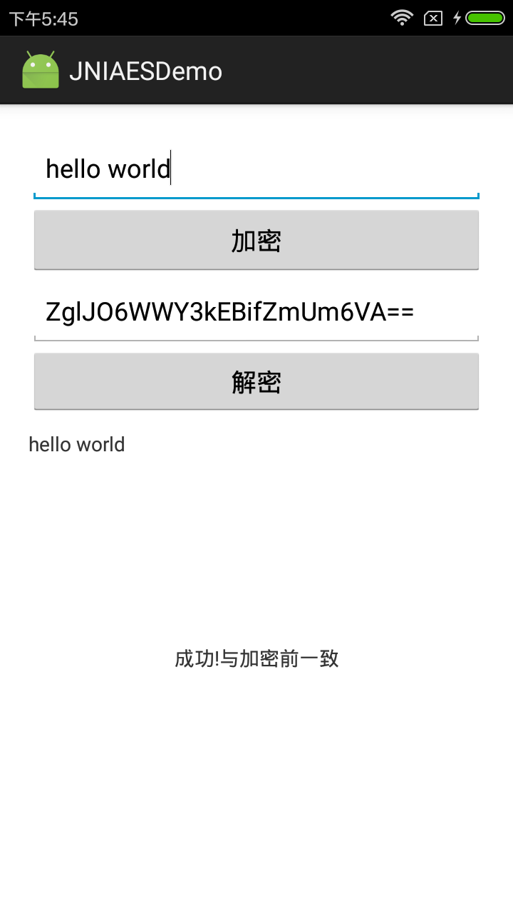

# Android JNI AES-128-ECB PKCS5Padding

这是一个通过 Android JNI 调用 C 实现 AES-128-ECB 加解密的示例工程。明文统一使用 UTF-8 编码，密文使用标准 Base64 输出，可处理空字符串、中文、emoji 和任意长度的数据。

> Java/Android 中的 `AES/ECB/PKCS5Padding` 对 AES 实际使用的是 16 字节分组的 PKCS#7 填充。本项目沿用原工程方法名中的 `PKCS5Padding`，以保持调用和协议命名兼容。

## 本次更新

- 修复 Base64 解码的栈越界、长度计算错误、非法字符及错误填充未校验问题。
- 修复 AES 解密返回栈内存地址、填充比较优先级错误、越界读写和结果末尾多出换行的问题。
- 修复 JNI 加解密结果的内存泄漏，并统一使用标准 UTF-8，支持 emoji 等补充字符。
- 对非法 Base64、错误密文长度和错误 PKCS#7 填充返回明确的中文异常信息。
- 移除明文、密文和密钥日志，避免敏感数据泄漏。
- 为底层 AES 分组操作增加并发保护。
- 从已废弃的 experimental Gradle 插件迁移到标准 Android Gradle Plugin 与 CMake 构建。
- 移除已废弃的 `armeabi`、MIPS ABI，支持 `armeabi-v7a`、`arm64-v8a`、`x86`、`x86_64`。
- 修复 Android 12 及以上版本要求的 `android:exported` 配置和原界面中文乱码。
- Activity 新增一键测试，覆盖常见长度、数值边界、特殊 UTF-8 文本和异常密文，并显示通过数与总数。

## 构建环境

| 项目                     | 版本            |
|------------------------|---------------|
| Android Gradle Plugin  | 9.3.0         |
| Gradle                 | 9.7.1         |
| JDK                    | 17            |
| compileSdk / targetSdk | 36            |
| minSdk                 | 21            |
| NDK                    | 28.2.13676358 |
| CMake                  | 3.22.1        |

Windows 下构建 Debug APK：

```powershell
$env:JAVA_HOME = 'C:\Program Files\Java\jdk-17.0.12'
.\gradlew.bat assembleDebug
```

产物位于 `app/build/outputs/apk/debug/app-debug.apk`。

## JNI 接口

Java 层接口保持不变：

```java
public native String getAESEncrypt(String str);

public native String getAESDecrypt(String str);
```

C 层接口显式传递数据长度，能够安全处理二进制数据中的 `\0`：

```c
AesResult AES_128_ECB_PKCS5Padding_Encrypt(
        const uint8_t *input,
        size_t input_length,
        const uint8_t *key,
        char **output);

AesResult AES_128_ECB_PKCS5Padding_Decrypt(
        const char *input,
        size_t input_length,
        const uint8_t *key,
        uint8_t **output,
        size_t *output_length);
```

调用成功后，输出内存由调用方通过 `free()` 释放。

## 兼容性示例

示例密钥仅用于验证协议兼容性：

```text
密钥：1234567890abcdef
明文：1
密文：qkrxxA9fIF636aITDRJhcg==
```

跨语言实现需保持以下参数完全一致：

- 算法：AES-128
- 模式：ECB
- 填充：PKCS#7（Java/PHP 常标记为 PKCS5Padding）
- 明文编码：UTF-8
- 密文编码：标准 Base64

## 原生回归测试

项目提供 [tests/native_test.c](tests/native_test.c)，覆盖固定向量、空数据、UTF-8、二进制零字节和异常密文：

```powershell
gcc -std=c11 -Wall -Wextra -Werror -pthread `
  -I app/src/main/jni `
  tests/native_test.c app/src/main/jni/aes.c app/src/main/jni/base64.c `
  -o native_test.exe
.\native_test.exe
```

## Activity 一键测试

运行 Demo 后点击“一键运行常见边界与异常测试”，会执行 35 项测试并显示“通过数/总数”。测试范围包括：

- AES 分组边界前后的 14 种长度，包括 0、1、15、16、17、4095、4096、4097 字节。
- `Integer`、`Long` 的最小值和最大值，以及 `-1`、`0`、`1`。
- 中文、emoji、空白字符、换行、内嵌空字符和类似 PKCS#7 填充的控制字符。
- 固定兼容向量与 ECB 相同输入结果一致性。
- `null`、空密文、非法 Base64、错误分组长度、错误 PKCS#7 填充及非规范 Base64 填充位。

## 安全说明

ECB 模式会让相同明文块产生相同密文，无法隐藏数据模式；示例中的硬编码密钥也不适合生产环境。新协议应优先使用带认证的 AES-GCM，并通过 Android Keystore 或安全的密钥协商机制管理密钥。不要在日志中输出明文、密文或密钥。

底层 AES 分组实现来源：[tiny-AES-c](https://github.com/kokke/tiny-AES-c)。

## Demo 截图


